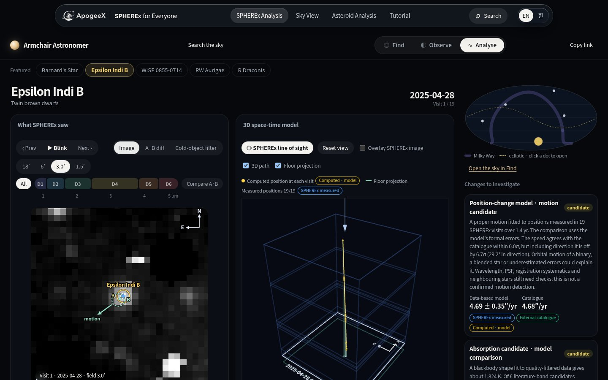
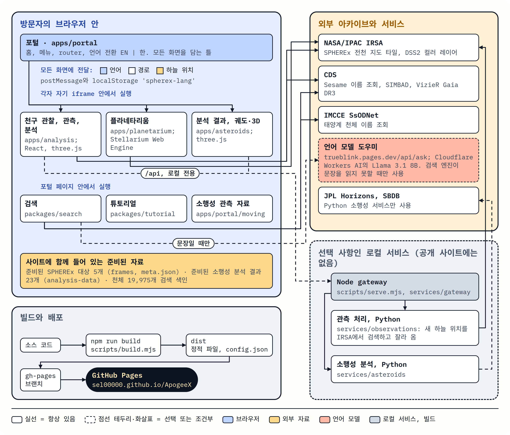
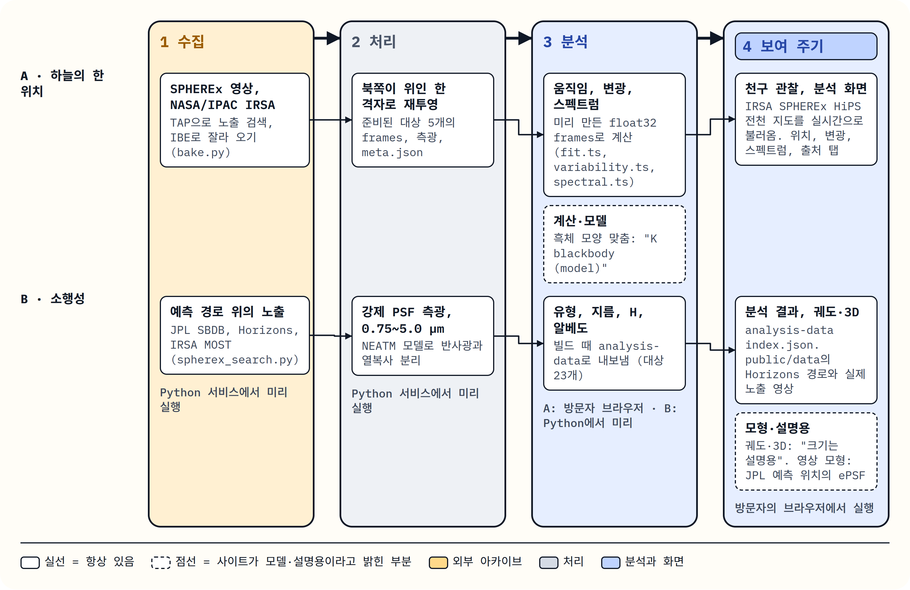
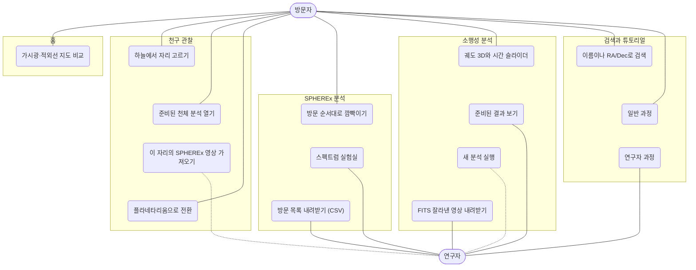
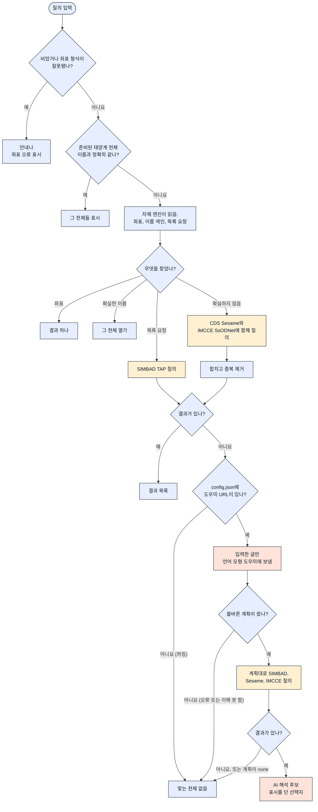
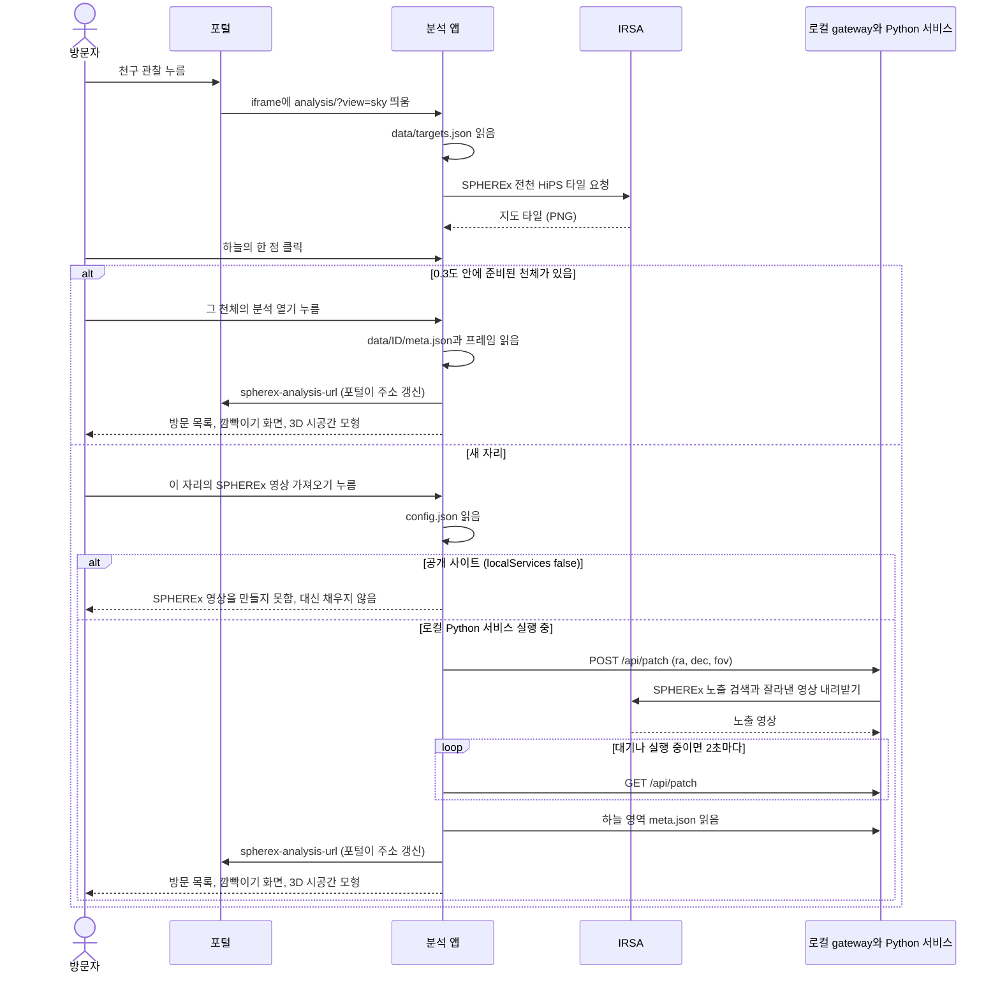
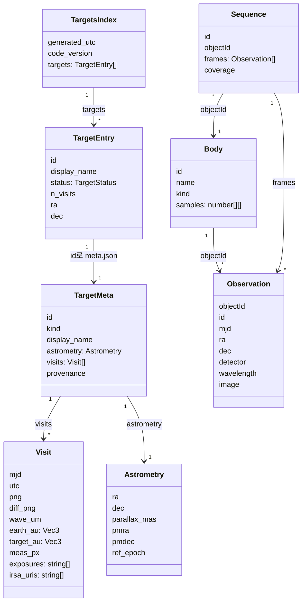
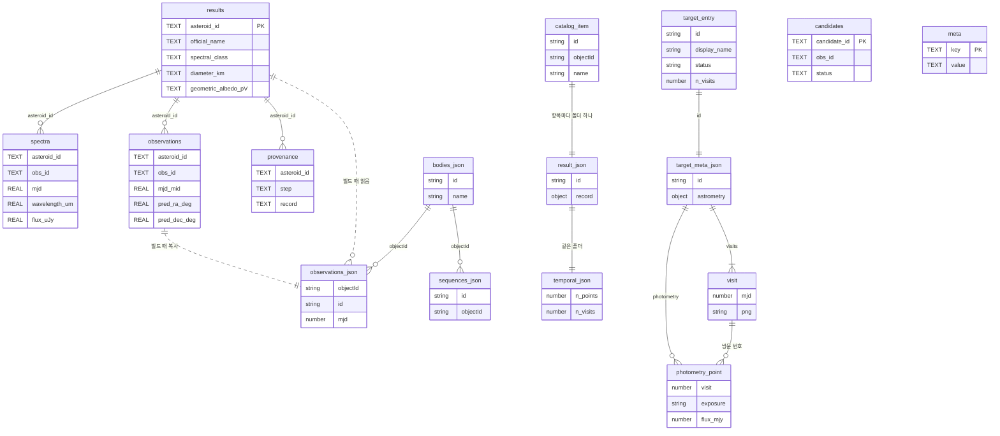

[English](README.md)

<div align="center">

<picture>
  <source media="(prefers-color-scheme: dark)" srcset="docs/readme/logo-dark.png">
  <source media="(prefers-color-scheme: light)" srcset="docs/readme/logo-light.png">
  
</picture>

<h1>모두를 위한 SPHEREx</h1>

<p>NASA SPHEREx의 실제 관측을 하늘의 한 자리마다 시간 순서로 보여 주어, 움직이거나 변하는 천체가 드러나게 하는 공개 웹 도구입니다.</p>

<p>
<a href="https://sel00000.github.io/ApogeeX/">공개 사이트</a> ·
<a href="README.md">English</a> ·
<a href="#무엇인가">하는 일</a> ·
<a href="#자료와-출처">자료와 출처</a> ·
<a href="#ai-사용">AI 사용</a> ·
<a href="#만든-사람">만든 사람</a> ·
<a href="#라이선스">MIT 라이선스</a>
</p>

</div>


## 무엇인가

모두를 위한 SPHEREx는 Team ApogeeX가 NASA Space Apps Challenge 2026의 챌린지 "Planet X and SPHEREx"에 낸 웹사이트입니다. NASA/IPAC 적외선 과학 아카이브(IRSA)의 SPHEREx 전천 지도에서 한 자리를 고르면, 그 자리를 찍은 실제 SPHEREx 영상을 시간 순서로 보여 줍니다. 공개 사이트에서는 준비된 다섯 대상에 대해 이 일을 하고, 그 밖의 자리는 IRSA에서 영상을 받아 오는 로컬 Python 서비스가 필요합니다. 여기에 플라네타리움, 실제 SPHEREx 영상과 연결한 소행성 궤도 3D, 영어와 한국어 이름을 알아듣는 검색, 튜토리얼이 함께 있습니다.

챌린지는 SPHEREx 자료로 움직이거나 변하는 천체를 어떻게 찾을 수 있는지 묻습니다. SPHEREx는 같은 하늘을 여러 적외선 파장으로 거듭 찍습니다. 이 사이트는 그 방문들을 나란히 놓고 같은 파장끼리 비교하며, 준비된 다섯 대상(Barnard's Star, Epsilon Indi B, WISE 0855-0714, RW Aurigae, R Draconis)의 위치·밝기·스펙트럼을 잽니다. 그 밖의 자리에서는 영상과 자료 출처만 제공합니다. 소행성은 JPL Horizons의 궤도를 그 소행성이 찍혔어야 할 SPHEREx 영상 옆에 놓습니다. 이 사이트는 새로운 발견을 주장하지 않습니다.

천문학자가 아닌 사람에게는 튜토리얼의 일반인 과정과 쉬운 말로 쓴 화면이 적외선 탐사가 무엇을 보는지, 블링크가 왜 움직임을 보여 주는지 설명합니다. 연구자에게는 모든 값에 출처 표시가 붙고, 연구자 과정이 좌표·원본 픽셀·파장 응답·불확도를 다루며, 분석 화면은 값이 나온 아카이브 파일로 거슬러 갈 수 있게 합니다.

## 둘러보기

<table>
<tr>
<td width="50%" valign="top"><br><b>천구 관찰.</b> 별자리 그림과 지면 보기가 있는 SPHEREx 전천 지도에서 자리를 고릅니다. 플라네타리움은 이 화면의 두 번째 보기입니다.</td>
<td width="50%" valign="top"><br><b>관측.</b> 같은 자리의 실제 노출을 같은 파장끼리 번갈아 봅니다.</td>
</tr>
<tr>
<td width="50%" valign="top"><br><b>분석.</b> 준비된 대상마다 위치, 변광, 스펙트럼, 자료 출처를 봅니다.</td>
<td width="50%" valign="top"><br><b>궤도 3D.</b> JPL의 소행성 궤도를 실제 SPHEREx 영상과 잇고, 은하수를 배경으로 행성 사이를 키보드로 날아다닙니다.</td>
</tr>
<tr>
<td width="50%" valign="top"><br><b>검색.</b> 자체 검색 엔진이 먼저 답합니다. 엔진이 읽지 못한 문장만 작은 언어 모형이 읽으며, 그런 결과에는 표시가 붙습니다.</td>
<td width="50%" valign="top"><br><b>튜토리얼.</b> 일반인 과정과 연구자 과정이 있고, 건너뛰거나 다시 볼 수 있습니다.</td>
</tr>
</table>

## 실제 자료와 그렇지 않은 것

분석 화면은 값에 "SPHEREx 측정", "외부 카탈로그", "계산·모델" 표시를 붙입니다. 그림에는 그림이라는 안내가 붙습니다.

| 종류 | 사이트의 예 |
|---|---|
| SPHEREx 측정 | 천구 관찰, 관측, 궤도 3D의 노출 영상(NASA/IPAC IRSA, SPHEREx DR1·QR3). 분석 화면에서 그 영상으로 잰 위치와 고유운동. |
| 외부 카탈로그 | Gaia DR3, SIMBAD, Hipparcos-2의 카탈로그 위치와 운동. JPL Horizons의 소행성 위치와 궤도. |
| 계산 또는 모형 | 스펙트럼 도구의 흑체 맞춤과 흡수 깊이. SPHEREx 영상 위에 겹친 소행성 예측 위치(ePSF 모형)와 참고 궤도 타원. |
| 설명용 그림·안내 그림 | 천구 관찰의 별자리 선 그림과 지면. 궤도 3D의 행성 크기, 암석 모양, 도식인 토성 고리. 궤도 3D 뒤의 은하수는 실제 Gaia 전천 지도이지만 SPHEREx 자료가 아닙니다. |

## 언어

사이트는 처음에 영어로 열리며, 상단 바의 `EN | 한` 스위치로 모든 화면과 검색, 튜토리얼을 새로고침 없이 한국어로 바꿉니다. 선택은 브라우저의 키 `spherex-lang` 하나에 저장되며, 상세는 [구조 문서](docs/architecture.md)에 있습니다.

## 로컬 실행

Node.js 22.13 이상과 Python 3.11 이상을 사용합니다. Windows에서는 `Start-Web.cmd`를 실행해도 됩니다.

```sh
npm run setup          # 웹 의존성 (앱마다 npm ci)
npm run setup:python   # Python 환경, 최초 한 번
npm run build
npm run preview        # http://127.0.0.1:4173/
# 웹 단계를 한 번에: npm start
npm test               # Python 환경이 필요합니다
```

Python 서비스가 없어도 홈, 천구 관찰, 플라네타리움, 준비된 대상, 준비된 소행성 결과와 궤도 3D, 검색, 튜토리얼을 볼 수 있습니다. 새 관측 영역 처리와 새 소행성 분석은 Python 서비스가 준비되어 있어야 합니다. 공개 사이트에는 Python 서버가 없습니다([deployment/public.json](deployment/public.json)의 `apiBase`가 빈 값). [무료 서버 배포와 제한](docs/public-server.md)을 확인하십시오. 공개 사이트는 빌드한 `dist` 폴더를 이 저장소의 `gh-pages` 브랜치에 올려 게시합니다.

프로젝트의 이전 기록은 [github.com/sel00000/Apogee](https://github.com/sel00000/Apogee)에 있습니다.

## 구조

### 시스템 구조



- **브라우저에서 실행.** 공개 사이트의 모든 부분, 즉 포털, 분석 앱(React), 플라네타리움(Stellarium Web Engine), 소행성 앱(three.js), 검색 엔진, 튜토리얼이 방문자의 브라우저에서 돌아갑니다.
- **포털이 화면을 담음.** 포털은 분석, 플라네타리움, 소행성 앱을 같은 출처의 iframe으로 띄우고 언어, 일시정지, 단계 전환 메시지를 보냅니다. 검색, 튜토리얼, 관측 탭은 포털 페이지 안에서 바로 돌아갑니다.
- **브라우저가 부르는 외부 서비스.** SPHEREx 전천 지도 타일은 IRSA에서, Gaia 별은 VizieR에서, 이름은 CDS Sesame, SIMBAD TAP, IMCCE SsODNet에서 가져오고, 검색이 아무것도 찾지 못했을 때만 언어 모형 도우미에 묻습니다.
- **선택 사항인 로컬 서비스.** 로컬 Node gateway가 새 하늘 영역 작업을 Python 서비스에 넘기면 이 서비스가 IRSA에서 SPHEREx 노출을 찾아 잘라 오고, 소행성 분석은 JPL과 IRSA를 쓰는 Python 서비스가 맡습니다. 준비된 천체 다섯 개와 준비된 소행성 결과는 사이트에 함께 들어 있습니다.
- **빌드와 배포.** `npm run build`가 모든 앱을 `dist` 폴더 하나로 묶고 API 서버가 없는 `config.json`을 넣습니다. 이 폴더를 `gh-pages` 브랜치에 올려 공개합니다.

### 아카이브에서 화면까지



이 블록 다이어그램은 자료가 거치는 네 단계를 보여 줍니다. 아카이브에서 모으고, 영상과 표로 처리하고, 분석한 뒤 화면에 띄웁니다. 왼쪽은 미리 돌려 두거나 로컬 서비스에서 돌아가고, 오른쪽은 브라우저에서 돌아갑니다.

### 방문자가 할 수 있는 일

유스케이스 다이어그램으로, 두 종류의 사용자가 화면마다 할 수 있는 주요 일을 정리했습니다.



점선으로 이은 두 가지는 로컬 Python 서비스가 있어야 하고, 나머지는 공개 사이트에서 그대로 됩니다.

### 검색이 답을 찾는 과정

검색창에 질의를 넣은 뒤 일어나는 일을 순서도로 그렸습니다.



### 천구 관찰에서 시계열까지

천구 관찰에서 자리를 고르고 그 자리의 SPHEREx 방문 자료를 받기까지를 시퀀스 다이어그램으로 그렸습니다.



### 주요 객체

분석 앱과 소행성 앱의 핵심 자료형을 클래스 다이어그램으로 정리했습니다.



### 사이트와 함께 배포하는 자료

미리 만든 소행성 데이터베이스(SQLite)와 브라우저가 읽는 JSON 자료의 관계를 ERD로 그렸습니다(`target_entry`는 `targets.json`의 항목 하나, `catalog_item`은 `analysis-data/index.json`의 항목 하나입니다).



SQLite 테이블끼리는 `asteroid_id`로 이어지지만 외래 키로 선언하지는 않았고, `candidates` 테이블은 비어 있습니다. 브라우저는 SQLite 파일을 열지 않습니다. 이 파일은 빌드 스크립트가 읽고, 로컬 소행성 서비스는 새 작업마다 데이터베이스를 따로 만듭니다. 사용자 계정도 없어서, 방문자별 상태는 브라우저 저장소에만 남습니다.

| 폴더 | 내용 |
|---|---|
| `apps/portal` | 홈, 메뉴, 언어 스위치, 다른 앱을 담는 틀. |
| `apps/analysis` | 천구 관찰의 지도와 관측·분석 화면(React). |
| `apps/planetarium` | Stellarium Web Engine 기반 플라네타리움. |
| `apps/asteroids` | 소행성 결과, 관측, 궤도 3D(three.js). |
| `packages/search` | 검색 엔진과 이름 색인. |
| `packages/tutorial` | 두 튜토리얼 과정. |
| `packages/contracts` | 하늘 영역 선택의 공통 형식. |
| `services` | 로컬 Node gateway와 관측·소행성 Python 서비스. |
| `data/prepared` | 사이트와 함께 배포하는 준비 자료. |
| `scripts` | 설치, 빌드, 로컬 서버, 테스트. |
| `deployment` | 공개 설정(`public.json`). |
| `docs` | 구조, AI 사용, 출처, 이 README의 그림. |

## 자료와 출처

| 자료·자산 | 출처 표기 | 라이선스·이용 조건 | 전체 고지 |
|---|---|---|---|
| SPHEREx 영상과 전천 큐브(DR1, QR3, Level 2) | NASA/IPAC Infrared Science Archive (IRSA) | 이 저장소에 라이선스 문서 없음 | [apps/analysis/THIRD_PARTY_NOTICES.md](apps/analysis/THIRD_PARTY_NOTICES.md) |
| 소행성 위치·속도 | JPL Horizons (NASA/JPL) | 이 저장소에 라이선스 문서 없음 | [apps/asteroids/README.md](apps/asteroids/README.md) |
| 궤도 3D의 은하수 배경 | ESA/Gaia/DPAC, 감사 표기 A. Moitinho | CC BY-SA 3.0 IGO (크기·형식을 바꾼 변형본) | [apps/asteroids/public/sky/SOURCES.json](apps/asteroids/public/sky/SOURCES.json) |
| Gaia DR3 위치·운동(VizieR I/355) | ESA/Gaia/DPAC, CDS 경유 | 값과 이름 찾기에만 사용 | [apps/analysis/THIRD_PARTY_NOTICES.md](apps/analysis/THIRD_PARTY_NOTICES.md) |
| Hipparcos-2 별 위치(VizieR I/311) | F. van Leeuwen 2007, A&A 474, 653 | CDS VizieR 이용 조건 | [apps/analysis/THIRD_PARTY_NOTICES.md](apps/analysis/THIRD_PARTY_NOTICES.md) |
| Stellarium Web Engine과 함께 든 하늘 자료 | Stellarium Labs SRL과 기여자 | AGPL-3.0 | [apps/planetarium/THIRD-PARTY-NOTICES.md](apps/planetarium/THIRD-PARTY-NOTICES.md) |
| 별자리 선 그림(western sky culture) | Stellarium's team | 글과 자료 CC BY-SA | [apps/analysis/THIRD_PARTY_NOTICES.md](apps/analysis/THIRD_PARTY_NOTICES.md) |
| 행성 지도: 수성, 금성, 지구, 화성, 목성 | NASA/MESSENGER/ASU/USGS; NASA/JPL Magellan, USGS; NASA Earth Observatory, R. Stöckli; NASA Ames/USGS Viking; NASA/JPL/Space Science Institute | 파일마다 공공 영역, NASA 이미지 지침, JPL 이미지 이용 정책 | [apps/asteroids/public/sky/SOURCES.json](apps/asteroids/public/sky/SOURCES.json) |
| 행성 지도: 토성, 천왕성, 해왕성 | NASA/ESA Hubble, Amy Simon과 OPAL 팀, STScI/MAST | STScI 콘텐츠 이용 정책 | [apps/asteroids/public/sky/SOURCES.json](apps/asteroids/public/sky/SOURCES.json) |
| 이름 찾기 | SIMBAD, Sesame (CDS, Strasbourg) | 고지에 감사 문구 기재 | [packages/search/NOTICE.md](packages/search/NOTICE.md) |
| 한국어 천체 이름 | Wikidata와 원본 프로젝트의 보충 자료 | CC0 (Wikidata) | [packages/search/NOTICE.md](packages/search/NOTICE.md) |
| 태양계 천체 찾기 | IMCCE SsODNet (quaero) | 이 저장소에 라이선스 문서 없음 | [packages/search/AI_USE.md](packages/search/AI_USE.md) |
| 플라네타리움의 수도 위치 | GeoNames; Natural Earth | CC BY 4.0; 공공 영역 | [apps/planetarium/THIRD-PARTY-NOTICES.md](apps/planetarium/THIRD-PARTY-NOTICES.md) |
| three.js | three.js authors | MIT | [apps/portal/vendor/three/LICENSE](apps/portal/vendor/three/LICENSE) |

"이 저장소에 라이선스 문서 없음"은 출처는 밝혔지만 이용 조건 문서를 저장소에 옮겨 두지 않았다는 뜻입니다.

## AI 사용

코드와 글의 상당 부분은 팀의 지시에 따라 Anthropic의 Claude(Claude Code 명령줄 도구)로 썼으며, 어느 부분인지는 아래 기록에 있습니다. 그 결과물은 다른 AI 에이전트가 검토했습니다. 화면의 영어 문구는 팀이 쓴 한국어 문구를 AI가 번역한 것입니다. 실행 중에는 검색이 자체 엔진으로 읽지 못한 문장을 작은 언어 모형(Cloudflare Workers AI의 Llama 3.1 8B)에 보낼 수 있습니다. 모형은 검색 계획만 돌려주고 천체·위치·숫자를 만들지 않으며, 그런 결과에는 "AI 해석 후보" 표시가 붙습니다. 사이트의 하늘 영상, 행성 지도, 관측은 AI가 만든 것이 아닙니다. 상세는 [docs/AI_USE.md](docs/AI_USE.md), [packages/search/AI_USE.md](packages/search/AI_USE.md), [apps/portal/moving/AI_USE-TrueBlink.md](apps/portal/moving/AI_USE-TrueBlink.md)에 있습니다.

프로젝트에서 팀이 쓴 AI 도구는 다음과 같습니다(팀이 밝힌 목록).

| 도구 | 모델 |
|---|---|
| Claude Code | Fable 5.2, Opus 5.5, Sonnet 5.5 |
| Codex | GPT 6 Astra, 6.1 Sol |
| NVIDIA | Nemotron 3.5 Lightning |
| Google Antigravity | Gemini 3.8 Flash |
| Meta | Llama 3.1 8B |
| SI | Super Intelligence |

이 README의 그림과 다이어그램은 AI가 코드를 보고 그렸고, 다른 AI 검수자가 상자와 화살표를 하나씩 코드와 맞춰 보았습니다. 화면 캡처는 AI가 헤드리스 브라우저로 실제 사이트를 찍은 것입니다. 팀 사진은 실제 사진입니다.

## 라이선스

이 저장소에서 팀이 직접 쓴 코드와 글은 MIT 라이선스([LICENSE](LICENSE))로 공개합니다. 다른 프로젝트에서 온 부분과 이미 라이선스가 있던 부분은 그 라이선스를 유지합니다.

| 부분 | 라이선스 |
|---|---|
| `apps/analysis` | MIT ([LICENSE](apps/analysis/LICENSE)). TrueBlink에서 가져온 파일은 Apache-2.0을 유지합니다([고지](apps/analysis/THIRD_PARTY_NOTICES.md)). |
| `apps/planetarium` | AGPL-3.0-only ([LICENSE-AGPL-3.0.txt](apps/planetarium/LICENSE-AGPL-3.0.txt)) |
| `packages/search` | Apache-2.0 ([LICENSE](packages/search/LICENSE)) |
| `apps/portal/moving` | Apache-2.0 ([LICENSE](apps/portal/moving/LICENSE)) |
| `apps/portal/vendor/three` | MIT ([LICENSE](apps/portal/vendor/three/LICENSE)) |
| 그 밖에 팀이 직접 쓴 코드: `apps/portal`(나머지), `apps/asteroids`, `packages/tutorial`, `packages/contracts`, `services`, `scripts`, `docs` | MIT ([LICENSE](LICENSE)) |

NASA, ESA 등이 제공한 자료·지도·영상은 이 라이선스의 대상이 아닙니다. 이용 조건은 [자료와 출처](#자료와-출처)에 적었습니다.

## 만든 사람

Team ApogeeX, NASA Space Apps Challenge 2026.


| 만든 사람 | 역할 |
|---|---|
| Kyung-Bo Kim | Architecture, Data Science (SPHEREx) |
| Jiho Lee | Data Science (asteroid) |
| Hankyeol Lee | UX/UI, Architecture, Astrophysical Validation |
| Joongsun You | Frontend, Data Science, Systems Engineering |
