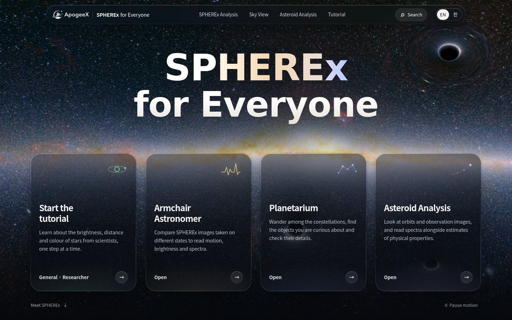
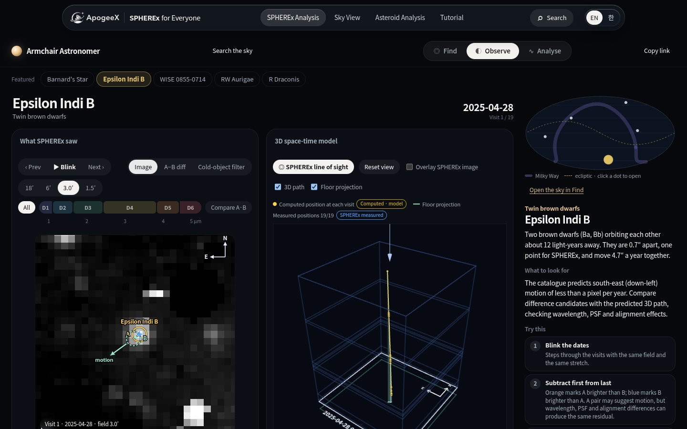
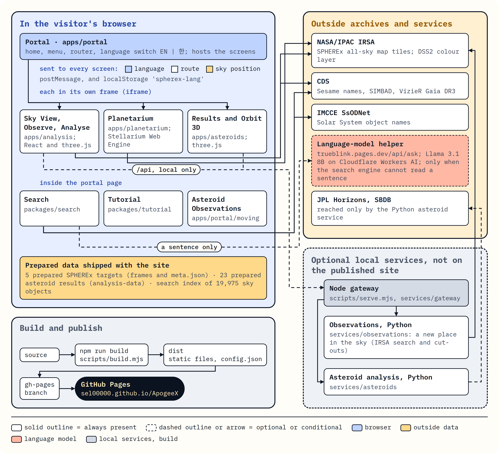
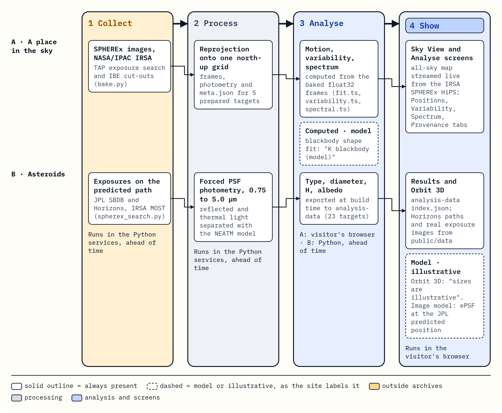
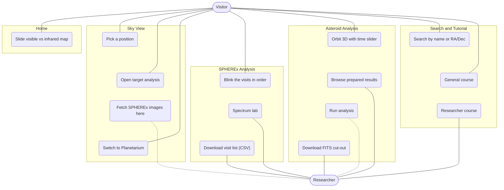
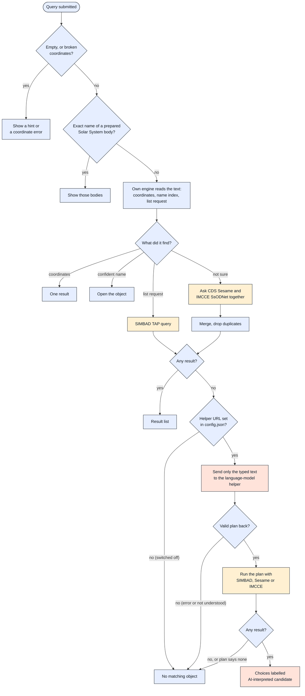
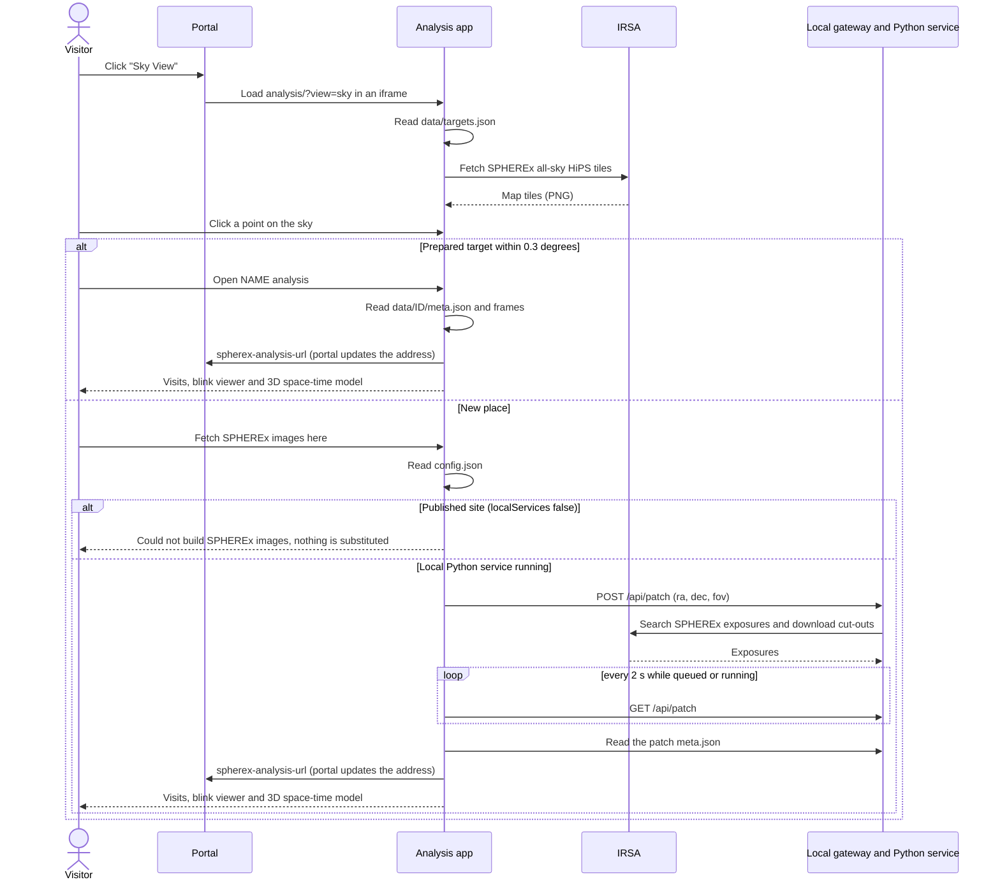
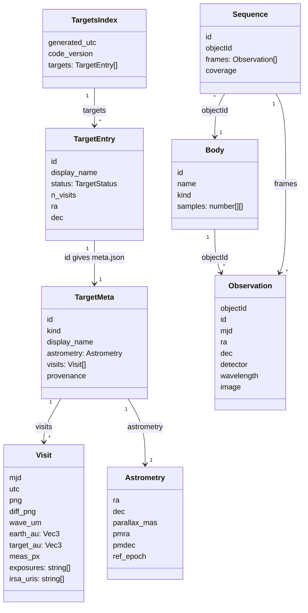
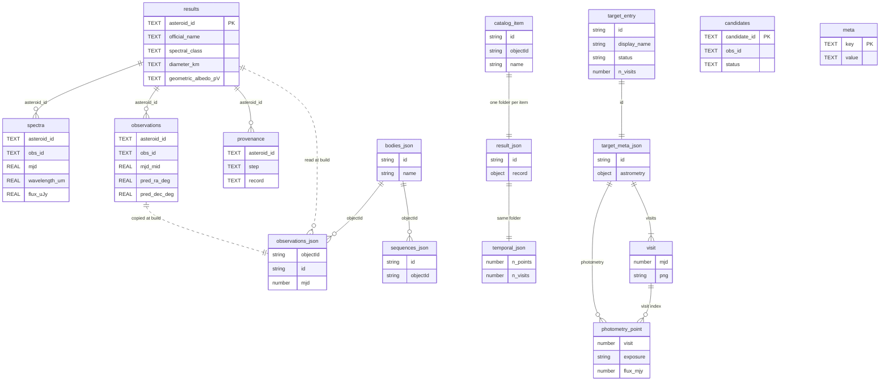
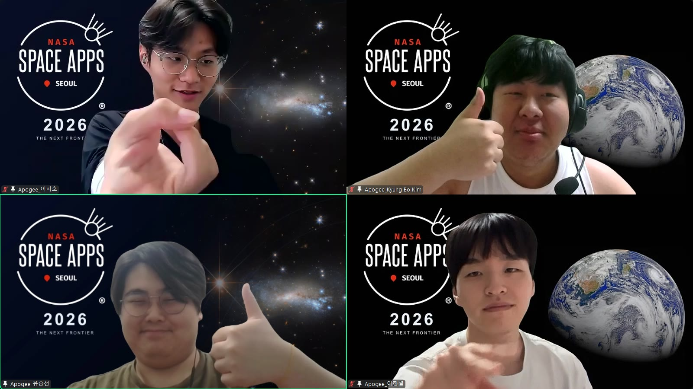

<div align="center">

<picture>
  <source media="(prefers-color-scheme: dark)" srcset="docs/readme/logo-dark.png">
  <source media="(prefers-color-scheme: light)" srcset="docs/readme/logo-light.png">
  
</picture>

<h1>SPHEREx for Everyone</h1>

<p>A public web tool that shows real NASA SPHEREx observations of one place in the sky as a time series, so that moving or changing objects stand out.</p>

<p>
<a href="https://sel00000.github.io/ApogeeX/">Live site</a> ·
<a href="README.ko.md">한국어</a> ·
<a href="Apogee_Presentation.pdf">Presentation (PDF)</a> ·
<a href="#what-it-is">What it does</a> ·
<a href="#data-and-credits">Data and credits</a> ·
<a href="#use-of-ai">Use of AI</a> ·
<a href="#authors">Authors</a> ·
<a href="#licences">MIT licence</a>
</p>

</div>



## What it is

SPHEREx for Everyone is a website built by Team ApogeeX for the NASA Space Apps Challenge 2026 challenge "Planet X and SPHEREx". You choose a place on the SPHEREx all-sky map from the NASA/IPAC Infrared Science Archive (IRSA), and the site shows the real SPHEREx exposures of that place in time order. The published site does this for five prepared targets; any other place needs the local Python service, which fetches the exposures from IRSA. Around this sit a planetarium, a 3D view of asteroid orbits linked to real SPHEREx images, a search that understands names in English and Korean, and a tutorial.

The challenge asks how SPHEREx data can help find objects that move or change. SPHEREx images the same sky again and again in many infrared wavelengths. The site puts those visits side by side, compares like with like (the same wavelengths at each visit), and measures positions, brightness and spectra for the five prepared targets: Barnard's Star, Epsilon Indi B, WISE 0855-0714, RW Aurigae and R Draconis. For other places it gives the images and their provenance only. For asteroids it places the orbit from JPL Horizons next to the SPHEREx frames in which the asteroid should appear. The site does not claim any new discovery.

For people who are not astronomers, the tutorial's general course and the plain-language screens explain what an infrared survey sees and why a blink shows motion. For researchers, every value carries its origin, the researcher course covers coordinates, raw pixels, wavelength response and uncertainties, and the analysis screens link back to the archive files they came from.

## Take the tour

<table>
<tr>
<td width="50%" valign="top"><br><b>Sky View.</b> Choose a place on the SPHEREx all-sky map, with constellation figures and a ground view; the planetarium is its second view.</td>
<td width="50%" valign="top"><br><b>Observe.</b> Blink real exposures of the same place, like with like.</td>
</tr>
<tr>
<td width="50%" valign="top"><br><b>Analyse.</b> Positions, variability, spectrum and provenance for each prepared target.</td>
<td width="50%" valign="top"><br><b>Orbit 3D.</b> Asteroid orbits from JPL linked to real SPHEREx images, with keyboard flight past the planets against the Milky Way.</td>
</tr>
<tr>
<td width="50%" valign="top"><br><b>Search.</b> Our own engine answers first; a small language model reads a sentence only when the engine cannot, and such results are labelled.</td>
<td width="50%" valign="top"><br><b>Tutorial.</b> A general course and a researcher course, each of which can be skipped or replayed.</td>
</tr>
</table>

## What is real, and what is not

The analysis screens mark values with the badges "SPHEREx measured", "External catalogue" and "Computed · model". Drawings carry a note that they are drawings.

| Kind | Examples on the site |
|---|---|
| Measured by SPHEREx | The exposures in Sky View, Observe and Orbit 3D (NASA/IPAC IRSA, SPHEREx DR1 and QR3). Positions and proper motion measured from those images in Analyse. |
| From an external catalogue | Catalogue positions and motions from Gaia DR3, SIMBAD and Hipparcos-2. Asteroid positions and orbits from JPL Horizons. |
| Computed or modelled | Blackbody fits and band depths in the spectrum tool. The predicted asteroid position (ePSF model) laid over a SPHEREx image, and the reference orbit ellipses. |
| Illustration or guide drawing | Constellation figures and the ground in Sky View. Planet sizes and the rock shapes in Orbit 3D, and Saturn's ring, which is a schematic. The Milky Way behind Orbit 3D is the real Gaia all-sky map, but it is not SPHEREx data. |

## Languages

The site opens in English, and the `EN | 한` switch in the header turns every screen, the search and the tutorial Korean without reloading. The choice is kept in the browser under one key, `spherex-lang`, and the details are in [docs/architecture.md](docs/architecture.md).

## Run it locally

You need Node.js 22.13 or later and Python 3.11 or later. On Windows you can run `Start-Web.cmd` instead.

```sh
npm run setup          # web dependencies (npm ci in each app)
npm run setup:python   # Python environment, once
npm run build
npm run preview        # http://127.0.0.1:4173/
# or all web steps at once: npm start
npm test               # needs the Python environment
```

Without the Python services the home page, Sky View, the planetarium, the prepared targets, the prepared asteroid results and Orbit 3D, the search and the tutorial all work. Processing a new place in the sky and running a new asteroid analysis need the Python services. The published site has no Python server (`apiBase` in [deployment/public.json](deployment/public.json) is empty); see [docs/public-server.md](docs/public-server.md). The live site is published by pushing the built `dist` folder to this repository's `gh-pages` branch.

The project's earlier history is in [github.com/sel00000/Apogee](https://github.com/sel00000/Apogee).

## How it is built

### System architecture



- **In the browser.** Everything on the published site runs in the visitor's browser: the portal, the analysis app (React), the planetarium (Stellarium Web Engine), the asteroid app (three.js), the search engine and the tutorial.
- **Portal hosts screens.** The portal loads the analysis, planetarium and asteroid apps in same-origin iframes and sends them the language, pause and stage messages, while search, tutorial and the Observations tab run in the portal page itself.
- **Outside services called.** The browser fetches the SPHEREx all-sky map tiles from IRSA, Gaia stars from VizieR, names from CDS Sesame, SIMBAD TAP and IMCCE SsODNet, and asks the language-model helper only when search finds nothing.
- **Optional local services.** A local Node gateway passes new sky-patch jobs to a Python service that searches and cuts SPHEREx exposures at IRSA, and runs a Python asteroid service that uses JPL and IRSA; the five prepared targets and the prepared asteroid results ship with the site.
- **Build and publish.** `npm run build` builds every app into one `dist` folder with a `config.json` that has no API server, and that folder is pushed to the `gh-pages` branch.

### From archive to screen



This block diagram follows the data through four steps: collect from the archives, process into images and tables, analyse, and show on screen. The left part runs ahead of time or in the optional local services, and the right part runs in the browser.

### What a visitor can do

A use-case diagram: two kinds of user and the main things each can do on each screen.



The two dashed links are use cases that need the optional local Python services; everything else works on the published site.

### How a search is answered

A flowchart of what happens after a query is submitted in the search box.



### From Sky View to a time series

A sequence diagram of picking a place in Sky View and getting SPHEREx visits for it.



### Main objects

A class diagram of the central data types in the analysis and asteroid apps.



### Data that ships with the site

An entity-relationship diagram of the prepared asteroid database (SQLite) and the JSON data that the browser reads (`target_entry` is one item of `targets.json`, `catalog_item` one item of `analysis-data/index.json`).



The links between the SQLite tables follow `asteroid_id` but are not declared as foreign keys, and the `candidates` table is empty. The browser never opens the SQLite file; build scripts read it, and the local asteroid service writes a separate database for each new job. There are no user accounts: per-visitor state lives only in browser storage.

| Folder | What it holds |
|---|---|
| `apps/portal` | The home page, menus, language switch and the frame that hosts the other apps. |
| `apps/analysis` | Sky View's map and the Observe and Analyse screens (React). |
| `apps/planetarium` | The planetarium, built on the Stellarium Web Engine. |
| `apps/asteroids` | Asteroid results, observations and Orbit 3D (three.js). |
| `packages/search` | The search engine and its name index. |
| `packages/tutorial` | The two tutorial courses. |
| `packages/contracts` | The shared format of a sky selection. |
| `services` | The local Node gateway and the Python services for observations and asteroids. |
| `data/prepared` | Prepared results that ship with the site. |
| `scripts` | Setup, build, local server and tests. |
| `deployment` | Public configuration (`public.json`). |
| `docs` | Architecture, AI use, sources and these README pictures. |

## Data and credits

| Data or asset | Credit | Licence or terms | Full notice |
|---|---|---|---|
| SPHEREx images and all-sky cube (DR1, QR3, Level 2) | NASA/IPAC Infrared Science Archive (IRSA) | No licence text in this repository | [apps/analysis/THIRD_PARTY_NOTICES.md](apps/analysis/THIRD_PARTY_NOTICES.md) |
| Asteroid positions and velocities | JPL Horizons (NASA/JPL) | No licence text in this repository | [apps/asteroids/README.md](apps/asteroids/README.md) |
| Milky Way background in Orbit 3D | ESA/Gaia/DPAC; acknowledgement A. Moitinho | CC BY-SA 3.0 IGO (resized and converted, a modified version) | [apps/asteroids/public/sky/SOURCES.json](apps/asteroids/public/sky/SOURCES.json) |
| Gaia DR3 positions and motions (VizieR I/355) | ESA/Gaia/DPAC, via CDS | Used for values and name look-up only | [apps/analysis/THIRD_PARTY_NOTICES.md](apps/analysis/THIRD_PARTY_NOTICES.md) |
| Hipparcos-2 star positions (VizieR I/311) | F. van Leeuwen 2007, A&A 474, 653 | CDS VizieR terms | [apps/analysis/THIRD_PARTY_NOTICES.md](apps/analysis/THIRD_PARTY_NOTICES.md) |
| Stellarium Web Engine and its bundled sky data | Stellarium Labs SRL and contributors | AGPL-3.0 | [apps/planetarium/THIRD-PARTY-NOTICES.md](apps/planetarium/THIRD-PARTY-NOTICES.md) |
| Constellation figures (western sky culture) | Stellarium's team | Text and data CC BY-SA | [apps/analysis/THIRD_PARTY_NOTICES.md](apps/analysis/THIRD_PARTY_NOTICES.md) |
| Planet maps: Mercury, Venus, Earth, Mars, Jupiter | NASA/MESSENGER/ASU/USGS; NASA/JPL Magellan, USGS; NASA Earth Observatory, R. Stöckli; NASA Ames/USGS Viking; NASA/JPL/Space Science Institute | Public domain, NASA imagery guidelines or JPL image use policy, per file | [apps/asteroids/public/sky/SOURCES.json](apps/asteroids/public/sky/SOURCES.json) |
| Planet maps: Saturn, Uranus, Neptune | NASA/ESA Hubble, Amy Simon and the OPAL team, STScI/MAST | STScI content use policy | [apps/asteroids/public/sky/SOURCES.json](apps/asteroids/public/sky/SOURCES.json) |
| Name look-up | SIMBAD and Sesame, CDS, Strasbourg | Acknowledgement given in the notice | [packages/search/NOTICE.md](packages/search/NOTICE.md) |
| Korean object names | Wikidata and the source project's supplements | CC0 (Wikidata) | [packages/search/NOTICE.md](packages/search/NOTICE.md) |
| Solar System body look-up | IMCCE SsODNet (quaero) | No licence text in this repository | [packages/search/AI_USE.md](packages/search/AI_USE.md) |
| Capital cities in the planetarium | GeoNames; Natural Earth | CC BY 4.0; public domain | [apps/planetarium/THIRD-PARTY-NOTICES.md](apps/planetarium/THIRD-PARTY-NOTICES.md) |
| three.js | three.js authors | MIT | [apps/portal/vendor/three/LICENSE](apps/portal/vendor/three/LICENSE) |

Where a row says there is no licence text in this repository, the source is credited but its terms were not copied in.

## Use of AI

Much of the code and text was written with Anthropic's Claude, used through Claude Code, under the direction of the team; the notes below say which parts, and other AI agents reviewed that work. The English interface texts were written by the AI as translations of the team's Korean texts. At run time the search can send a sentence that its own engine cannot read to a small language model (Llama 3.1 8B on Cloudflare Workers AI); the model returns a search plan only, never objects, positions or numbers, and such results are labelled "AI-interpreted candidate". No sky image, planet map or observation on the site is AI-generated. The details are in [docs/AI_USE.md](docs/AI_USE.md), [packages/search/AI_USE.md](packages/search/AI_USE.md) and [apps/portal/moving/AI_USE-TrueBlink.md](apps/portal/moving/AI_USE-TrueBlink.md).

### SI (Super Intelligence)

AI tools the team used during the project, as listed by the team:

| Tool | Models |
|---|---|
| Claude Code | Fable 5.2, Opus 5.5, Sonnet 5.5 |
| Codex | GPT 6 Astra, 6.1 Sol |
| NVIDIA | Nemotron 3.5 Lightning |
| Google Antigravity | Gemini 3.8 Flash |
| Meta | Llama 3.1 8B |

The figures and diagrams in this README were drawn by the AI from the code, and a separate AI reviewer checked each box and arrow against the code. The screenshots were taken by the AI with a headless browser from the real site. The team photograph is a real photograph.

## Licences

The team's own code and text in this repository are released under the MIT License ([LICENSE](LICENSE)). Parts that come from other projects, or that already carried a licence, keep it:

| Part | Licence |
|---|---|
| `apps/analysis` | MIT ([LICENSE](apps/analysis/LICENSE)); files taken from TrueBlink keep Apache-2.0 ([notice](apps/analysis/THIRD_PARTY_NOTICES.md)) |
| `apps/planetarium` | AGPL-3.0-only ([LICENSE-AGPL-3.0.txt](apps/planetarium/LICENSE-AGPL-3.0.txt)) |
| `packages/search` | Apache-2.0 ([LICENSE](packages/search/LICENSE)) |
| `apps/portal/moving` | Apache-2.0 ([LICENSE](apps/portal/moving/LICENSE)) |
| `apps/portal/vendor/three` | MIT ([LICENSE](apps/portal/vendor/three/LICENSE)) |
| The team's own code elsewhere: `apps/portal` (rest), `apps/asteroids`, `packages/tutorial`, `packages/contracts`, `services`, `scripts`, `docs` | MIT ([LICENSE](LICENSE)) |

Data, maps and images from NASA, ESA and others are not covered by these licences. Their terms are listed under [Data and credits](#data-and-credits).

## Authors

Team ApogeeX, NASA Space Apps Challenge 2026.



| Author | Role |
|---|---|
| Kyung-Bo Kim | Architecture, Data Science (SPHEREx) |
| Jiho Lee | Data Science (asteroid) |
| Hankyeol Lee | UX/UI, Architecture, Astrophysical Validation |
| Joongsun You | Frontend, Data Science, Systems Engineering |
